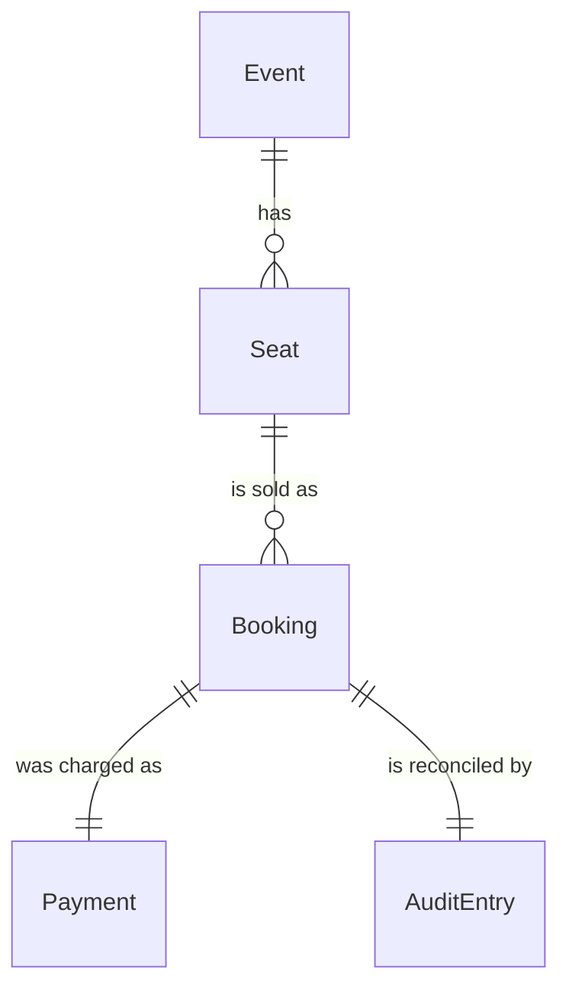

# Domain

A small box office for reserved-seat events. Buyers browse events, look at the
seat map, optionally hold a seat while they decide, and book it, which charges
their payment method and records the sale for the venue.

## Entities

| Entity | What it is |
| --- | --- |
| `Event` | A performance at a venue. Carries `OnSaleAtUtc` — the instant bookings open. Requests before that instant are rejected. |
| `Seat` | One seat at one event, labelled by row and number (`12A`). Availability is derived when you read the seat map, not stored as a status machine. |
| `Booking` | The durable outcome of a sale: seat, buyer email, amount, creation instant. |
| `Payment` | The record of the charge behind a booking. One per booking. |
| `AuditEntry` | One row per confirmed booking, written for the venue's reconciliation. Finance reads this table; gaps in it are treated as incidents. |

## Money and payments

Payments are charged through an in-process stub that always succeeds — there is
no network call and no secret anywhere in this codebase. The stub sits behind an
interface precisely so tests (and, one day, a real provider) can substitute it.
A declined charge surfaces as `402 Payment Required`.

## Time

Every stored timestamp ends in `Utc` and is a UTC value. Product code never
reads the machine clock directly: the current time always comes from the
injected `TimeProvider`. The test suite substitutes a fake clock, which is why
the tests can talk about "five minutes later" without ever sleeping.

## Conventions this codebase follows

- **Thin controllers.** A controller binds input, calls one service method, and
  returns the result. Domain decisions and database work live in
  `src/BoxOfficeApi/Services`.
- **DTOs at the boundary.** Endpoints accept and return records from
  `src/BoxOfficeApi/Dtos`. Entity classes never appear in a controller
  signature or a serialized response.
- **Errors are ProblemDetails.** Three exception types carry the contract:
  `NotFoundException` becomes `404`, `ConflictException` becomes `409`, and
  `PaymentFailedException` becomes `402` — all returned as
  `application/problem+json`. Throw them from a service; the middleware does
  the rest. Invalid input is a `400` from model validation, before anything
  reaches a service.

## A known limitation

There is no way to hold a seat while a buyer types their card details. Seats go
straight from available to booked, and the fastest click wins. The venue has
asked for holds more than once.
